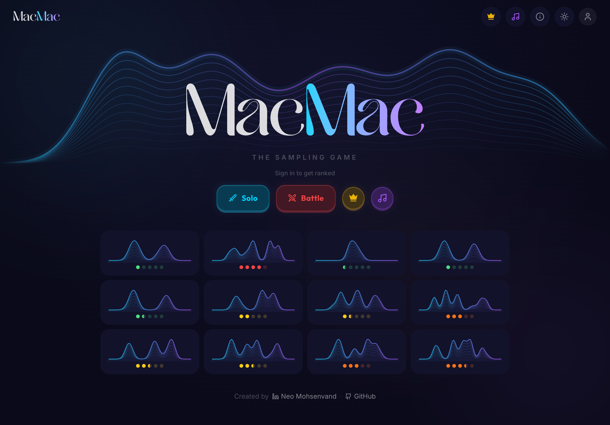

# macmac

A game that builds intuition for [Markov Chain Monte Carlo](https://en.wikipedia.org/wiki/Markov_chain_Monte_Carlo) — one of the most important ideas in computational statistics and machine learning.



## How it works

See a target probability density. Click to place samples. A [kernel density estimate](https://en.wikipedia.org/wiki/Kernel_density_estimation) builds in real time to show how well your samples match the target shape.

Your score balances two objectives:

- **Shape match** — measured by mean squared error (MSE) between the peak-normalized target PDF and your KDE. Both curves are scaled so their maximum equals 1, then compared point-by-point. Up to 8,000 points.
- **Time bonus** — up to 2,000 extra points for speed, decaying linearly to zero over 30 seconds.

There is no explicit click penalty; time naturally penalizes extra clicks. The best players find the sweet spot: enough samples to capture the distribution's shape, placed strategically where the density matters most — without wasting time.

## Game modes

### Solo

Procedurally generated levels with difficulties from 1 to 10. Each level is seeded, so the same difficulty always produces the same target distribution. The grid adapts to your skill — as you play, levels center around your player rating. Complete levels to climb the solo leaderboard.

### Battle

Real-time 1v1 multiplayer. Get matched with an opponent, race to sample the same target distribution in 30 seconds. See your opponent's KDE curve update live. Win by getting a higher score. An ELO rating system (K=32, starting at 1200) tracks battle rankings. Hit 90%+ match accuracy for an instant jackpot win.

## Tech stack

- [Svelte 5](https://svelte.dev/) + [SvelteKit](https://kit.svelte.dev/) + TypeScript
- [Tailwind CSS v4](https://tailwindcss.com/)
- [Drizzle ORM](https://orm.drizzle.team/) + [Turso](https://turso.tech/) (libSQL)
- [Better Auth](https://www.better-auth.com/) for GitHub & Google sign-in
- [PartyServer](https://github.com/cloudflare/partykit/tree/main/packages/partyserver) on Cloudflare Workers for real-time multiplayer (WebSocket matchmaking + battle rooms)
- [KaTeX](https://katex.org/) for math rendering on the About page
- Canvas API for game visualization
- Deployed on [Vercel](https://vercel.com/)

## Local development

```bash
git clone https://github.com/NeoVand/MacMac.git
cd MacMac
npm install
```

Use Node.js 22.18 or newer (Node.js 24 recommended).

Copy `.env.example` to `.env` and fill in your values:

```bash
cp .env.example .env
```

For local development with a file-based SQLite database, set:

```
DATABASE_URL=file:local.db
```

For sign-in to work, add your OAuth credentials (GitHub and/or Google). See `.env.example` for all options.

Push the database schema and start the dev server:

```bash
npm run db:push
npm run dev
```

### PartyServer (multiplayer)

Battle mode requires a Cloudflare Worker with two SQLite-backed Durable Objects: `Main` for battle rooms and `Matchmaker` for the queue. To run locally:

```bash
cd party
npm install
cp .dev.vars.example .dev.vars
npm run dev
```

Set `VITE_BATTLE_HOST=localhost:1999` in the app's `.env`. Use the same `PARTYKIT_SECRET` in `.env` and `party/.dev.vars` to save authenticated battle ratings. Never commit either secret file.

To deploy:

```bash
cd party
npx wrangler login
npx wrangler secret put PARTYKIT_SECRET
npm run deploy
```

`wrangler` prints the new `macmac-battle.<your-subdomain>.workers.dev` host. Set `VITE_BATTLE_HOST` to that host in Vercel, set the matching `PARTYKIT_SECRET`, and redeploy the app. The secret retains its existing name so signed battle results stay compatible. `VITE_PARTYKIT_HOST` remains a fallback during the transition.

### Migrating off hosted PartyKit

Production moved to `macmac-battle.mostafa-m-v-b.workers.dev` on October 12, 2026. Both battle host settings in Vercel point to this Worker, and the additive database migrations have been applied. The live app remains at [macmac.lol](https://macmac.lol).

The [hosted platform shutdown](https://blog.partykit.io/posts/hosted-platform-shutdown/) disables deploys and data export on **October 16, 2026**, then removes hosted projects on **October 23, 2026**. Follow the [official migration guide](https://docs.partykit.io/guides/migrate-to-partyserver/) for background.

This project stores battle queues and live matches only in memory. It never writes application data to PartyKit room storage. Solo scores, player profiles and ratings live in the separate Turso database, so there is no room data to export for this implementation. In-progress matches and queued players cannot be transferred; perform the cutover during a quiet period. Keep the old service available until the app points at the verified Worker.

Deploy in this order:

1. Apply the additive score receipt migration using the production database credentials: `npm run db:migrate:saves`. It creates only `score_submissions` and `battle_claims`; existing scores and players are preserved. It is safe to rerun.
2. Log in to the intended Cloudflare account, set `PARTYKIT_SECRET` to the app's existing value (or set a new matching value on both services), and deploy from `party`.
3. Check `https://<new-worker-host>/health`, then verify matchmaking and a complete battle with two browser sessions.
4. Set `VITE_BATTLE_HOST` and `PARTYKIT_SECRET` in Vercel and deploy the updated app. The host is compiled into the app, so changing it requires a rebuild.
5. Verify a guest solo game through both GitHub and Google sign-in: the same samples, time, score and result dialog must return, followed by automatic saving. Confirm a saved battle updates its rating too.

If a frontend rollback is necessary, keep the additive receipt table. Existing clients without submission IDs remain supported. Before October 23, an older app can still point at the old PartyKit host; after shutdown, keep the new Worker host in the frontend configuration.

### Guest scores and sign-in

Solo games are checkpointed in the current browser tab before leaving for sign-in, including the samples, time, reset count and a stable save ID. Sign-in from a completed result automatically saves that result after the session loads. Sign-in during play restores the unfinished game. A failed login or save keeps the checkpoint for retry; a confirmed save clears it. Repeated saves use a database receipt to avoid counting the same attempt twice. Completed guest battles also retain their signed result through sign-in and can be claimed once within 24 hours. One account can claim only one participant result per battle; authenticated battle reports retain their existing five-minute validity window.

### Validation

```bash
npm test
npm run check
npm run build
cd party
npm run check
npm test
```

The app tests use a temporary SQLite database, never the configured Turso database. The multiplayer integration test runs an isolated local Cloudflare runtime and checks matchmaking, the countdown, live KDE messages and signed end-of-game results. Browser sign-in callbacks should also be verified with the real providers after deployment.

## Deployment

The app is configured for Vercel with a Turso database:

1. Create a free [Turso](https://turso.tech/) database
2. Push to GitHub
3. Import the repo in [Vercel](https://vercel.com/)
4. Set environment variables:
   - **Required:** `DATABASE_URL`, `DATABASE_AUTH_TOKEN`, `ORIGIN`, `BETTER_AUTH_SECRET`
   - **For sign-in:** `GITHUB_CLIENT_ID`, `GITHUB_CLIENT_SECRET`, `GOOGLE_CLIENT_ID`, `GOOGLE_CLIENT_SECRET`
   - **For battles:** `VITE_BATTLE_HOST` (your deployed Worker host), `PARTYKIT_SECRET` (matching the Worker secret)
5. Deploy

## Created by

[Neo Mohsenvand](https://github.com/NeoVand)
